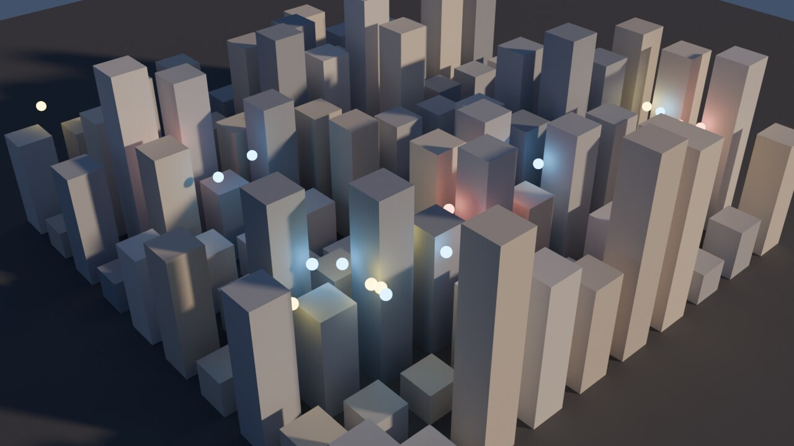

# Procedural City & Traffic, a Blender add-on (Python · bpy)


<sub>A 10×10 city and 22 "cars" generated by the add-on, rendered headlessly in Cycles.</sub>

**English** · [Español](#español)

A Blender add-on written for *Computer Animation* (Animación, BSc Multimedia Engineering, Universitat de València, 2024-25) as a group project developed over five phases. It generates a **procedural city** and fills it with **vehicles animated by custom interpolation drivers**. It also covers orientation along a path, speed control and character animation.

### Features
- **Procedural city**: a grid of blocks with configurable street count, block size, street width and a random building-height range, with buttons to generate and clear it.
- **Car generator**: spawns vehicles on random streets and directions (N↔S, E↔W) with random routes with turns (`crear_ruta.py`), keyframed according to a speed in streets per second.
- **Custom interpolation through drivers**: object position is computed by a Python driver (`posicion.py → get_posicion`) that interpolates between keyframes with:
  - **Linear**
  - **Hermite**, with per-key velocities
  - **Catmull-Rom**, with configurable tension
- **Oscillation**: optional pendular motion on X/Y/Z with amplitude and frequency.
- **Orientation along a path (Phase 3)**: quaternion-based heading so the car faces its direction of travel, with **banking** in curves.
- **Speed control (Phase 4)**: the car can run along the path at constant speed, or accelerate on straights and brake before curves.
- **Character animation & VFX (Phase 5)**: rigging and skinning, forward and inverse kinematics, motion-capture clean-up on a troll character, and a final VFX shot compositing the animation over live footage.

### Install
1. Zip the `coches_addon/` folder (or download `coches_addon.zip` from *Releases*).
2. Blender → *Edit › Preferences › Add-ons › Install…* → pick the zip → enable **CreacionCoches**.
3. The panels **"Ciudad Procedural: Parametros"** and **"Generador de coche: Parametros"** appear in the 3D Viewport sidebar.

Tested with Blender 3.x–4.2.

### Repository layout
```
coches_addon/                  final add-on (city + cars + interpolation drivers)
src/practica1..3, practica5    code and .blend files of each phase
src/cuaternion_circuito/       Phase 3 – quaternion orientation and banking on a circuit
src/control_velocidad_circuito Phase 4 – speed control
doc/LEEME_Fase1..5.md          phase write-ups (in Spanish) with links to videos
```

### Videos
| Phase | Video |
|---|---|
| 3 – Orientation & banking | [Final render](https://youtu.be/f3K-VEeumSE) · [UI walkthrough](https://youtu.be/VUtARhZld3E) |
| 4 – Speed control | [Final render](https://youtu.be/v9OgkVtKDNM) · [UI walkthrough](https://youtu.be/KiNEzUZn-hA) |
| 5 – Skinning, IK, mocap & VFX | [VFX shot](https://youtu.be/wYPDEBXJoao) · [Breakdown](https://youtu.be/KbGdNv68fyQ) |

[](https://youtu.be/f3K-VEeumSE) [](https://youtu.be/wYPDEBXJoao)

### Team
Group project by four students (Group 06). Academic work — please don't submit it as your own.

---

## Español

Add-on de Blender hecho en grupo para la asignatura *Animación* (Ingeniería Multimedia, UV, 2024-25), desarrollado a lo largo de cinco fases.

- **Ciudad procedural**: rejilla de manzanas con número de calles, tamaño de manzana, ancho de calle y rango de alturas configurables.
- **Generador de coches**: aparecen en calles y direcciones aleatorias, con rutas con giros y velocidad en calles por segundo.
- **Interpolación propia mediante drivers**: lineal, Hermite (con velocidades) y Catmull-Rom (con tensión), más una oscilación pendular opcional.
- **Orientación con cuaterniones y alabeo** en las curvas (fase 3).
- **Control de velocidad** a lo largo de la trayectoria: velocidad constante, o aceleración en las rectas y frenada antes de las curvas (fase 4).
- **Skinning, cinemática directa e inversa, captura de movimiento y VFX** con un personaje troll (fase 5).

**Instalación:** comprime `coches_addon/` en un zip e instálalo desde *Preferencias › Add-ons*. Los paneles aparecen en la barra lateral del visor 3D. La documentación de cada fase está en `doc/` y los vídeos en la tabla de arriba.

Es un trabajo en grupo de cuatro personas (Grupo 06). Proyecto académico: no lo entregues como propio.
