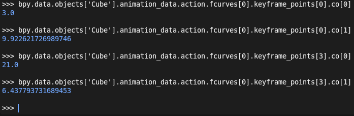

# Fase 1 del Proyecto

## Introducción

Este documento describe el proceso de desarrollo de un script para la generación de trayectorias usando tres métodos de interpolación.
Se describe una mini guía de como usar el add-on.

## Estructura del Documento

- [Ejercicio 1](#ejercicio-1-generación-de-trayectorias): Generación de trayectorias en los ejes X e Y.
- [Ejercicio 2](#ejercicio-2-inserción-de-keyframes): Inserción de keyframes.
- [Ejercicio 3](#ejercicio-3-interpolación-lineal): Interpolación lineal entre keyframes.
- [Ejercicio 4](#ejercicio-4-creación-de-drivers-y-panel): Creación de drivers y panel personalizado.
- [Guía de uso del Add-on](#guía-de-uso-del-add-on): Instrucciones para instalar y usar el add-on.
- [Vídeos](#vídeos): Vídeos con los contenidos indicados en la práctica.

---

## Ejercicio 1: Generación de Trayectorias

Se han desarrollado dos scripts para generar un bucle que mueve un objeto en los ejes X e Y. Lo más relevante de cada script es:

Movimiento en el eje X: 
- [posicion_x.py](../src/practica1/posicion_x.py)

En él se usa el coseno para variar la posición del objeto, haciéndolo oscilar sobre ese eje.

```python
import bpy

if t <= 0:
    posx = radio
elif t > 0:
    posx = math.cos(vel * t) * radio
```

Movimiento en el eje Y:

- [posicion_y.py](../src/practica1/posicion_y.py)

En este eje se hace oscilar al objeto por el eje y usando el seno.

```python
import bpy

if t <= 0:
    posy = 0.0
elif t > 0:
    posy = math.sin(vel * t) * radio
```

## Ejercicio 2: Inserción de Keyframes

En el ejercicio 2 se han insertado mediante la interfaz gráfica 4 keyframes, en el fotograma 3, 7, 15, 21.
- Escribiendo en la consola se puede observar que se han puesto correctamente como se ilustra en la figura: 

## Ejercicio 3: Interpolación Lineal

Para este ejercicio, se modificó la función 'get_posicion' de [posicion.py](../src/practica1/posicion.py), para realizar una interpolación lineal entre los keyframes. 
- El código busca el primer keyframe mayor al frame actual en la lista de keyframes del objeto:

```python
while i < len(lista_keyframes.keyframe_points) and lista_keyframes.keyframe_points[i].co[0] < frm:
    i += 1
```
- Si i es 0 o el último índice, la posición es la del primer o último keyframe respectivamente.
- Si no, se calcula la posición usando la fórmula de interpolación vista en clase.

## Ejercicio 4: Creación de Drivers y Panel

Se ha desarrollado un bucle que llama a la función de asignar driver en cada coordenada x, y, z:

```python
def invoke(self, context, event):
    scene = context.scene  # Guarda el contexto de la escena en una variable
    obj = context.object
    
    for c in range(3):
        pos.asigna_driver_posicion(obj, c)
    
    return {"FINISHED"}
```

- Y se creó un panel que permite el control de los drivers 
    - [panel_driver.py](../src/practica1/panel_driver.py)

## EnumProperty para Selección de Interpolación

Se ha añadido una propiedad EnumProperty para seleccionar el método de interpolación desde un menú desplegable en [panel_drivers.py](../src/practica1/panel_driver.py).

```python
bpy.types.Object.metodo = bpy.props.EnumProperty(
    name="metodo", 
    description="Selecciona una interpolación",
    items=[
        ('LN', "Lineal", ""),
        ('HRMT', "Hermite", "Interpolación de Hermite"),
        ('C-R', "Catmull-Rom", "Interpolación Catmull-Rom")
    ],
    default='LN',
)
```
- Se ha cambiado el código para que según la opción que se elija se llame a una función u otra.
```python
if obj.metodo == 'LN':
            # Llamada a la función de interpolación lineal
        elif obj.metodo == 'HRMT':
            # Llamada a la función de interpolación de Hermite
        elif obj.metodo == 'C-R':
            # Llamada a la función de interpolación de Catmull-Rom
```
- Avanzado en la implementación matricial de hermite. Falta la velocidad del punto anterior.

# Implementación Matricial de Hermite

- Se ha comenzado la implementación de la interpolación Hermite utilizando matrices. Debido a ciertos problemas con las matrices, se decidió usar una forma estándar de cálculo.
- Para mantener un registro de las velocidades en cada punto, se ajustaron usando keyframes en las propiedades de Hermite. Estos valores se toman como entrada para la interpolación.

## Guía de Uso del Add-on

1. Instalar el script desde el menú de Add-ons en Blender.

2. Posicionar el objeto donde se desee poniendo keyframes en las posciones y la velocidad de Hermite.

3. Seleccionar del desplegable un método de interpolación y darle a "Crear trayectoria".

> [!NOTE] Si se desea ver el trazo del camino, seleccionar en las propiedades del objeto "Motion Paths" y darle a "Calculate" o "Update path".

## Vídeos 

A continuación se indica el enlace a YouTube de los vídeos con los contenidos indicados en la práctica.

[Captura en la que se configura una escena utilizando el complemento. La secuencia muestra cómo se instala el add-on, los elementos de panel que se generan, y un ejemplo de utilización.] (https://youtu.be/HO7wnKenDtQ)

[Vídeo en el que se ve primero la captura de Blender y después los renders, como indica la práctica, también se encuentra en la descripción del primer vídeo.] (https://youtu.be/9UGtlZqQWzU)

---